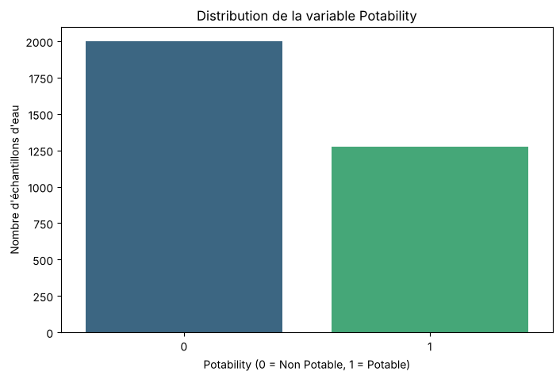
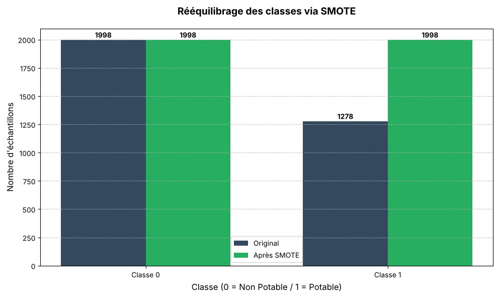
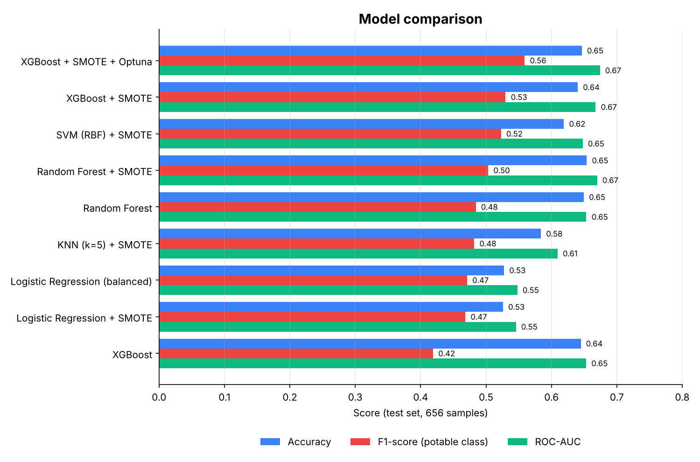
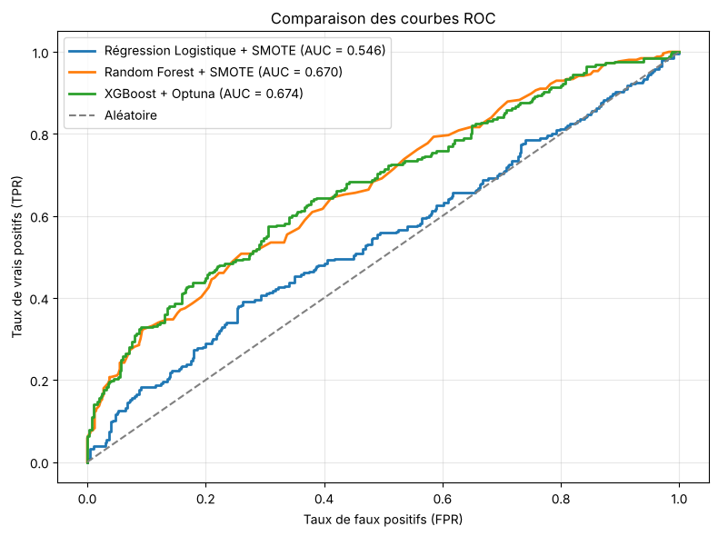
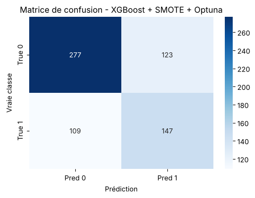
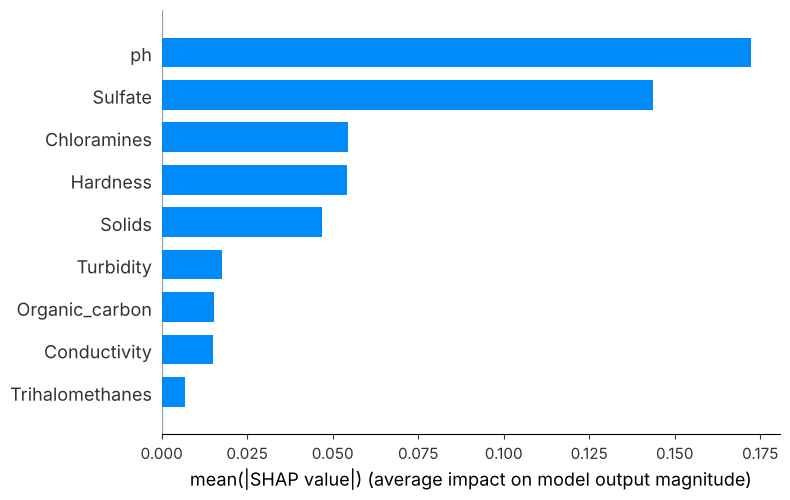

<div align="center">

# 💧 Water Potability Prediction

### Machine Learning for Drinking Water Quality Classification

Predicting whether water is potable from physicochemical measurements, using supervised machine learning, SMOTE, Optuna and SHAP.


</div>

---

## 📌 Project Overview

Access to safe drinking water is essential for public health. This project explores how machine learning can classify water samples as **potable** or **not potable** using nine physicochemical characteristics.

The task is a **binary classification problem**:

- `0` — Not potable
- `1` — Potable

The workflow covers data exploration, preprocessing, class-imbalance handling with SMOTE, comparison of several models, hyperparameter tuning with Optuna, and model interpretation with SHAP.

> **Disclaimer:** This is an academic machine-learning exercise. Predictions are not a substitute for laboratory water testing or official drinking-water safety standards.

## 🏆 Key Results

| | |
|---|---|
| **Best model (F1, potable class)** | XGBoost + SMOTE + Optuna |
| **Accuracy** | 64.63% |
| **F1-score (class 1)** | 55.89% |
| **ROC-AUC** | 0.674 |
| **Most influential features (SHAP)** | `ph`, `Sulfate`, `Chloramines`, `Hardness` |

The dataset is known to be hard: the nine measurements separate the two classes only partially, so scores stay modest. See [Limitations](#️-limitations) for an honest reading of these numbers.

## 🎯 Objectives

- Explore and understand the water-quality dataset.
- Prepare numerical features and handle missing values.
- Address class imbalance using SMOTE on the training data only.
- Train and compare several classification models.
- Tune the best model with Optuna.
- Evaluate with Accuracy, Precision, Recall, F1-score and ROC-AUC.
- Explain the best model with SHAP.

## 📂 Repository Structure

```text
water-potability-prediction/
├── Drinking_water.csv
├── water_potability.ipynb
├── requirements.txt
├── README.md
├── .gitignore
└── images/
    ├── class-distribution.png
    ├── smote-balance.png
    ├── model-comparison.png
    ├── roc-curves.png
    ├── confusion-matrix.png
    └── feature-importance.png
```

## 📊 Dataset

The project uses the Kaggle *Water Potability* dataset, provided as `Drinking_water.csv`.

| Property | Value |
|---|---:|
| Original rows | 3,276 |
| Target variable | `Potability` |
| Input features after cleaning | 9 |
| Classes | 2 (61% not potable / 39% potable) |
| Training samples | 2,620 |
| Test samples | 656 |

### Input features

| Feature | Description |
|---|---|
| `ph` | Acidity / alkalinity level |
| `Hardness` | Water hardness |
| `Solids` | Total dissolved solids |
| `Chloramines` | Chloramine concentration |
| `Sulfate` | Sulfate concentration |
| `Conductivity` | Electrical conductivity |
| `Organic_carbon` | Organic carbon concentration |
| `Trihalomethanes` | Trihalomethanes concentration |
| `Turbidity` | Water cloudiness |

The original file also contains an index column and two completely empty columns (`Carcinogenics`, `medical_waste`), all removed during cleaning. Missing values: `ph` (491), `Sulfate` (781), `Trihalomethanes` (162), imputed with the column mean. There are no duplicate rows.

### Class distribution

The target is imbalanced: 1,998 non-potable samples against 1,278 potable ones.



## 🧪 Methodology

1. **Data loading and inspection**: dimensions, types, missing values, target distribution.
2. **Data cleaning**: removal of the index column and the two empty columns.
3. **Missing-value treatment**: mean imputation for `ph`, `Sulfate` and `Trihalomethanes`.
4. **Train/test split**: 80/20, stratified, `random_state=42`.
5. **Feature scaling**: `StandardScaler` fitted on the training set only.
6. **Class balancing**: **SMOTE** on the training set only, so no synthetic sample reaches the test set.
7. **Model training**: Logistic Regression, KNN, SVM, Random Forest and XGBoost, with and without SMOTE.
8. **Hyperparameter tuning**: **Optuna** (30 trials, TPE sampler, seed 42) on XGBoost.
9. **Evaluation**: all models are compared on the same untouched test set.
10. **Interpretation**: global and local explanations with **SHAP**.



## 🤖 Models Compared

- Logistic Regression (class weights, and SMOTE)
- K-Nearest Neighbors + SMOTE
- Support Vector Machine (RBF) + SMOTE
- Random Forest (class weights, and SMOTE)
- XGBoost (baseline, SMOTE, and SMOTE + Optuna)

## 📈 Results

Metrics were obtained by executing the notebook on the provided CSV file (test set, 656 samples). Precision, Recall and F1-score refer to the **potable class (`Potability = 1`)**.

| Model | Accuracy | Precision | Recall | F1-score | ROC-AUC |
|---|---:|---:|---:|---:|---:|
| **XGBoost + SMOTE + Optuna** | 64.63% | 54.44% | 57.42% | **55.89%** | **0.674** |
| XGBoost + SMOTE | 64.02% | 54.07% | 51.95% | 52.99% | 0.668 |
| SVM (RBF) + SMOTE | 61.89% | 51.12% | 53.52% | 52.29% | 0.648 |
| Random Forest + SMOTE | **65.40%** | 57.21% | 44.92% | 50.33% | 0.670 |
| Random Forest | 64.94% | 56.84% | 42.19% | 48.43% | 0.653 |
| KNN (k=5) + SMOTE | 58.38% | 46.86% | 49.61% | 48.20% | 0.609 |
| Logistic Regression (balanced) | 52.74% | 41.82% | 53.91% | 47.10% | 0.548 |
| Logistic Regression + SMOTE | 52.59% | 41.64% | 53.52% | 46.84% | 0.546 |
| XGBoost (baseline) | 64.48% | 57.93% | 32.81% | 41.90% | 0.653 |

### Performance comparison



### ROC curves



### Best model

According to the **F1-score of the potable class**, the best model is **XGBoost + SMOTE + Optuna**. Random Forest + SMOTE has a slightly higher accuracy (65.40%) but misses more potable samples (recall 44.92%).

### Confusion matrix



| | Predicted not potable | Predicted potable |
|---|---:|---:|
| **Actual not potable** | 277 (True Negative) | 123 (False Positive) |
| **Actual potable** | 109 (False Negative) | 147 (True Positive) |

### Feature importance (SHAP)



`ph` and `Sulfate` have by far the largest impact on the predictions, followed by `Chloramines`, `Hardness` and `Solids`. `Trihalomethanes` contributes the least. SHAP describes how the fitted model behaves; it does not prove causal relationships.

## ⚠️ Limitations

- **Hyperparameters tuned on the test set.** In the notebook, Optuna maximizes the F1-score directly on the test set, so the XGBoost + Optuna score is slightly optimistic. Re-running the tuning with 5-fold cross-validation on the training set only (SMOTE inside each fold) gives on the test set: accuracy ≈ 63%, F1 ≈ 0.50, ROC-AUC ≈ 0.64. This is the most reliable estimate of real-world performance.
- **Imputation before the split.** Means are computed on the whole dataset before the train/test split (minor leakage). A scikit-learn `Pipeline` would avoid it.
- **Limited predictive signal.** The nine features alone give an AUC around 0.67.
- **Single split.** Results come from one train/test split, without repeated cross-validation.

## 🔭 Possible Improvements

- Tune with cross-validation instead of the test set.
- Build a full `Pipeline` (imputation → scaling → SMOTE → model).
- Tune the decision threshold to improve potable-class recall.
- Add calibration and precision-recall curve analysis.
- Validate on an independent dataset.
- Build a small web application (Streamlit) to demonstrate predictions.

## 🛠️ Tech Stack

- **Python**: programming language
- **Pandas / NumPy**: data manipulation
- **Matplotlib / Seaborn / Plotly**: visualization
- **Scikit-learn**: preprocessing, models and evaluation
- **Imbalanced-learn**: SMOTE
- **XGBoost**: gradient-boosted trees
- **Optuna**: hyperparameter optimization
- **SHAP**: model explainability
- **Jupyter Notebook**: experimentation and analysis

## 🚀 Getting Started

### 1. Clone the repository

```bash
git clone https://github.com/YOUR_GITHUB_USERNAME/water-potability-prediction.git
cd water-potability-prediction
```

### 2. Create and activate a virtual environment

**Windows (PowerShell):**

```bash
python -m venv .venv
.venv\Scripts\Activate.ps1
```

**macOS / Linux:**

```bash
python3 -m venv .venv
source .venv/bin/activate
```

### 3. Install dependencies

```bash
pip install -r requirements.txt
```

### 4. Launch the notebook

```bash
jupyter notebook water_potability.ipynb
```

Run the cells from top to bottom (**Kernel → Restart & Run All**). Results are reproducible (seed 42 for the split, SMOTE, models and Optuna). The CSV file must stay in the same folder as the notebook.
---

<div align="center">

If you find this project useful, consider giving it a ⭐ on GitHub.

**Made with Python and Machine Learning.**

</div>
